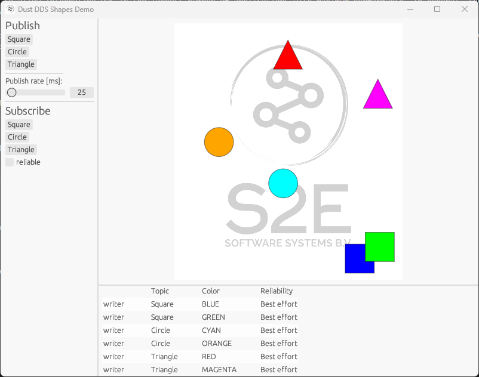

# Dust DDS

[](https://dl.circleci.com/status-badge/redirect/gh/s2e-systems/dust-dds/tree/main)
[](https://crates.io/crates/dust_dds)
[](https://docs.rs/dust_dds)
[](https://github.com/s2e-systems/dust-dds/blob/main/LICENSE)
[](#browser-connectivity-via-webassembly--webrtc)
[](#omg-dds-security-v11-plugin-work-in-progress)
[](https://www.s2e-systems.com)

[Dust DDS](https://dust-dds.s2e-systems.com) is a native Rust implementation of the [Data Distribution Service (DDS)](https://www.omg.org/omg-dds-portal/) middleware and [Real-time Publisher-Subscriber (RTPS)](https://www.omg.org/spec/DDSI-RTPS/About-DDSI-RTPS/) wire protocol standard developed by [S2E Software Systems](https://www.s2e-systems.com).

Dust DDS provides peer-to-peer, data-centric connectivity for Physical AI, robotics, defense, aerospace, and mission-critical embedded systems. It uses only stable Rust with `#![forbid(unsafe_code)]` in the core engine.

---

## Example

### Publisher

```rust
use dust_dds::{
    domain::domain_participant_factory::DomainParticipantFactory,
    infrastructure::{listener::NO_LISTENER, qos::QosKind, status::NO_STATUS, type_support::DdsType},
};

#[derive(DdsType)]
struct HelloWorldType {
    #[dust_dds(key)]
    id: u8,
    msg: String,
}

let domain_id = 0;
let participant_factory = DomainParticipantFactory::get_instance();

let participant = participant_factory
    .create_participant(domain_id, QosKind::Default, NO_LISTENER, NO_STATUS)
    .unwrap();

let topic = participant
    .create_topic::<HelloWorldType>("HelloWorld", "HelloWorldType", QosKind::Default, NO_LISTENER, NO_STATUS)
    .unwrap();

let publisher = participant
    .create_publisher(QosKind::Default, NO_LISTENER, NO_STATUS)
    .unwrap();

let writer = publisher
    .create_datawriter::<HelloWorldType>(&topic, QosKind::Default, NO_LISTENER, NO_STATUS)
    .unwrap();

let hello_world = HelloWorldType {
    id: 8,
    msg: "Hello world!".to_string(),
};
writer.write(hello_world, None).unwrap();
```

### Subscriber

```rust
use dust_dds::{
    domain::domain_participant_factory::DomainParticipantFactory,
    infrastructure::{listener::NO_LISTENER, qos::QosKind, status::NO_STATUS, type_support::DdsType},
};

#[derive(Debug, DdsType)]
struct HelloWorldType {
    #[dust_dds(key)]
    id: u8,
    msg: String,
}

let domain_id = 0;
let participant_factory = DomainParticipantFactory::get_instance();

let participant = participant_factory
    .create_participant(domain_id, QosKind::Default, NO_LISTENER, NO_STATUS)
    .unwrap();

let topic = participant
    .create_topic::<HelloWorldType>("HelloWorld", "HelloWorldType", QosKind::Default, NO_LISTENER, NO_STATUS)
    .unwrap();

let subscriber = participant
    .create_subscriber(QosKind::Default, NO_LISTENER, NO_STATUS)
    .unwrap();

let reader = subscriber
    .create_datareader::<HelloWorldType>(&topic, QosKind::Default, NO_LISTENER, NO_STATUS)
    .unwrap();

if let Ok(hello_world_sample) = reader.read_next_sample() {
    println!("Received: {:?}", hello_world_sample.data.unwrap());
}
```

---

## Key Architectural Features

* **Brokerless Peer-to-Peer Discovery**: Nodes dynamically discover each other over the network via standard RTPS discovery. There is no central broker to configure, bottleneck, or introduce a single point of failure.
* **Fine-Grained Quality of Service (QoS)**: Contract-based data delivery policies built natively into the wire protocol (Reliability, Durability, Deadline, Liveliness, History, and Ownership).
* **Deterministic Memory Safety**: Pure, stable Rust eliminates memory safety CVEs, buffer overflows, and data races in multi-threaded stacks without runtime garbage collector pauses.
* **Modular Pluggable Transports**: Configurable transport architecture supporting standard UDP/IP (v4 and v6), zero-copy shared memory (`iceoryx2`), and WebRTC DataChannels.
* **Multi-Platform Support**: Runs on desktop Linux, macOS, and Windows, safety-critical RTOSes (QNX, VxWorks), resource-constrained microcontrollers (`no_std`), and web browsers via WebAssembly.

---

## Defining DDS Types

Dust DDS allows topic types to be defined natively in Rust using the `DdsType` derive macro:

```rust
use dust_dds::infrastructure::type_support::DdsType;

#[derive(DdsType)]
struct SensorData {
    #[dust_dds(key)]
    sensor_id: u32,
    timestamp: u64,
    reading: f64,
}
```

DDS types can also be generated from OMG IDL v4 specifications using the [`dust_dds_gen`](https://crates.io/crates/dust_dds_gen) crate.

For full technical documentation on:
* Container attributes (`name`, `extensibility`, `nested`, `base_type`)
* Field attributes (`key`, `id`, `optional`, `default_value`, `non_serialized`, `external`, `hashid`, `try_construct`)
* Single inheritance (`base_type` and `parent` field mapping)
* Enumerated types (`bit_bound`) and XTypes Unions (`switch`, `case`, `default`)
* IDL type generation

Please refer to the [DDS Type Definition and IDL Guide](https://github.com/s2e-systems/dust-dds/blob/main/dds/docs/type_support.md).

---

## Synchronous and Asynchronous API

Dust DDS provides both synchronous and asynchronous APIs to support diverse application architectures:

* **Synchronous API**: Follows the standard DDS specification using DDS listeners and waitsets for event-driven architectures. Recommended for standard embedded and multi-threaded systems.
* **Asynchronous API**: Built for async runtimes such as [Tokio](https://tokio.rs). When integrating with Tokio, the asynchronous API must be used to avoid panics resulting from blocking calls inside the runtime.

---

## Multi-Language and Ecosystem Bindings

* **WebAssembly (`dust_dds_wasm`)**: WebAssembly bindings running in browsers with WebRTC DataChannels for teleoperation and telemetry.
* **Python Bindings (`dust-dds-python`)**: Connects AI training and inference pipelines (PyTorch, JAX) and simulation platforms directly to DDS topics without IPC conversion overhead.
* **C / C++ Bindings**: Stable C-compatible API allowing incremental integration into existing C and C++ codebases.
* **ROS 2 RMW (`rmw_dust_dds`)**: Drop-in ROS 2 RMW implementation supporting active ROS 2 distributions (Humble, Jazzy).
* **Microcontrollers (`no_std`)**: Support for bare-metal targets and microcontrollers with a pre-built runtime using the Embassy async framework.

---

## Commercial Extensions & Engineering Services

[S2E Software Systems](https://www.s2e-systems.com) offers commercial software modules, platform porting, and engineering services for production deployments of Dust DDS:

### OMG DDS Security v1.1 Plugin (Work in Progress)
A pure-Rust implementation of the OMG DDS Security v1.1 specification, delivering cryptographic protection without OpenSSL dependencies:
* **Authentication**: PKI mutual authentication with X.509 certificates.
* **Access Control**: Fine-grained, signed topic governance and permissions.
* **Wire Cryptography**: AES-GCM (128/256-bit) payload encryption and message authentication (MAC).
* *Status*: Under active development. Contact S2E for roadmap access and pilot evaluation.

### Custom Transport Implementation
Design and qualification of custom transport drivers for specialized hardware buses and determinism requirements:
* Time-Sensitive Networking (TSN / IEEE 802.1Qbv)
* PCIe interconnects and FPGA shared-memory buffers
* Tactical radio, SATCOM, and custom RF links

### Platform & RTOS Porting
Porting, hardening, and qualification of Dust DDS for customer hardware targets and certified operating environments:
* Safety-critical RTOSes (QNX Neutrino, Wind River VxWorks)
* Small-footprint targets (Zephyr RTOS, FreeRTOS, bare-metal `no_std`)
* Board bring-up with automated Hardware-in-the-Loop (HIL) qualification

### Technical Training & Support SLAs
* **Workshops**: Hands-on engineering workshops covering DDS QoS tuning, distributed systems architecture, and Rust integration into legacy C/C++ stacks.
* **Commercial Support**: Commercial SLAs, dedicated issue resolution, and long-term support (LTS) backports available upon request.

For inquiries, contact [info@s2e-systems.com](mailto:info@s2e-systems.com) or visit [s2e-systems.com](https://www.s2e-systems.com).

---

## Shapes Demo

DDS interoperability is typically validated using a shapes demo. The Dust DDS Shapes Demo is included in this repository and can be launched with:

```bash
cargo run --package dust_dds_shapes_demo
```



---

## License

This project is licensed under the Apache License Version 2.0.
